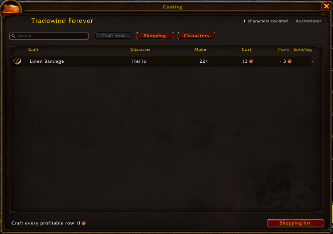
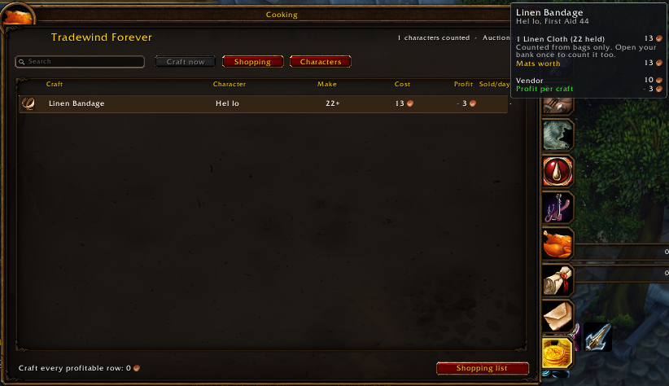
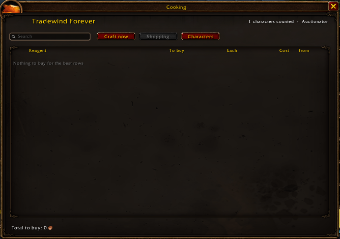
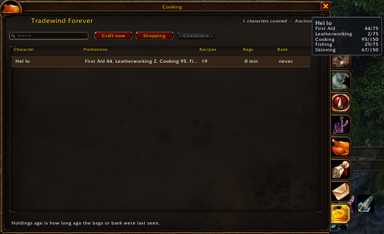
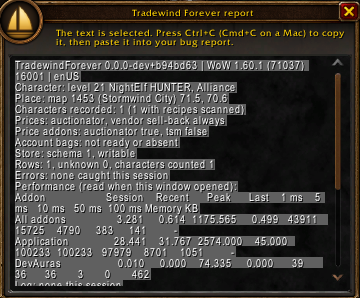

Tradewind Forever adds a Tradewind tab to the Professions window: which recipes pay for each of your characters, counting only what that character holds in its own bags and bank. It lists and explains; it never crafts, buys or posts.

Prices come from Auctionator or TradeSkillMaster when you have one installed, and what your other characters hold from Syndicator. Nothing is guessed: with no price source, an auction price is unknown, not zero. Nothing is sent to other players.

Free, with nothing locked behind it. If it saves you time, you can [sponsor me on GitHub](https://github.com/sponsors/cjber), which takes no fees, or [buy me a coffee on Ko-fi](https://ko-fi.com/cjber). For help and each day's release notes, [join me on Discord](https://discord.gg/FpHugGxRJY).

  

**Known limitations**

- A price is never guessed. Without Auctionator or TradeSkillMaster, an auction price is unknown and shown as ?, not zero; unknown amounts are left out of every total.
- A character you have not logged in to with Tradewind installed shows as not scanned, and a bank you have not opened since installing counts as unknown holdings.
- Holdings come from the client's own counts, or Syndicator when it knows the character. Without Syndicator, a character's bank is counted from the client's cached bank contents, which has not been confirmed on the Forever client; equipped items count as held only without Syndicator.
- A merchant's price is only known after you have opened that merchant's window once.
- Recipes and sell prices are bundled from the game's data at one client build.
- Auction house cut and sales per day follow SkillUp Forever's figures and have not been re-checked on the Forever client.
- The client refuses an addon opening the Professions window, so /tradewind asks you to open it and then shows the tab.

Craft now lists what your characters can make from what they hold, by profit. A count with "+" means the bank has not been seen yet, so the bags alone were counted.

Hover a row for its reagents, what each is worth and where the item sells best.

Shopping lists the reagents to buy to make the best rows again, priced from the auction house or a merchant.

Characters shows what each of your characters knows and how fresh its counts are.

`/tradewind report` sums up what the addon has recorded.

These images are generated previews of the Tradewind Forever UI.

## Features

- **Craft now.** Each character's recipes it can make now, ranked by profit per craft.
- **Shopping.** The reagents to buy to make the best rows again.
- **Characters.** What is recorded for each of your characters.
- **Report.** `/tradewind` or `/tw` shows a report to copy into a bug report: versions, what the addon found, and any errors it caught.
- **Price sources.** Reads Auctionator and TradeSkillMaster through their public APIs when installed.
- **Other characters.** Reads what your other characters hold from Syndicator when installed.

## Usage

- `/tradewind` or `/tw` opens the Tradewind tab in the Professions window.
- For a bug report, paste `/tradewind report`.

<!-- forever-family:start -->

## The Forever addons

Each one works on its own, and they work together when you install more than one.

| Addon | What it does | Issues |
|---|---|---|
| [Shortest Path Forever](https://www.curseforge.com/wow/addons/shortest-path-forever) | Plans journeys on foot, by air, by sea and through portals, with directions in the tracker. | [Issues](https://github.com/cjber/shortest-path-forever/issues) |
| [Adventure Guide Forever](https://www.curseforge.com/wow/addons/adventure-guide-forever) | Suggests quests for your level and routes you from one to the next. | [Issues](https://github.com/cjber/adventure-guide-forever/issues) |
| [SkillUp Forever](https://www.curseforge.com/wow/addons/skillup-forever) | Shows skill-up chances, recipe costs and levelling routes in the Professions window. | [Issues](https://github.com/cjber/skillup-forever/issues) |
| [Legacy Forever](https://www.curseforge.com/wow/addons/legacy-forever) | Shows your unfinished Legacy challenges on the world map and tracks the ones you choose. | [Issues](https://github.com/cjber/legacy-forever/issues) |
| [Tweaks Forever](https://www.curseforge.com/wow/addons/tweaks-forever) | Adds quest automation, rare alerts and merchant options to the game's settings. | [Issues](https://github.com/cjber/tweaks-forever/issues) |
| [Field Guide Forever](https://www.curseforge.com/wow/addons/field-guide-forever) | Keeps a cosmetic journal of the creatures you kill, zone by zone. | [Issues](https://github.com/cjber/field-guide-forever/issues) |
| [Commissions Forever](https://www.curseforge.com/wow/addons/commissions-forever) | Lists your commission turn-ins, the materials in your bags and the next NPC to visit. | [Issues](https://github.com/cjber/commissions-forever/issues) |
| [Macro Assist Forever](https://www.curseforge.com/wow/addons/macro-assist-forever) | Adds a macro window with every macro in one list, a mono editor with live checks, and history. | [Issues](https://github.com/cjber/macro-assist-forever/issues) |

Bug reports, feature requests and pull requests are welcome on each addon's GitHub. Everyone whose report or idea ships is thanked by name on the Thanks page in game, in the store page and in the changelog, unless they ask not to be.

For help, ideas and each day's release notes, join [cjber's Workshop on Discord](https://discord.gg/FpHugGxRJY).

<!-- forever-family:end -->

<!-- forever-credits:start -->

Thanks to everyone who reports a bug or asks for a feature.

<!-- forever-credits:end -->

Source code and issues: [github.com/cjber/tradewind-forever](https://github.com/cjber/tradewind-forever). Licence: GPL-3.0-or-later.

Built with AI assistance.
